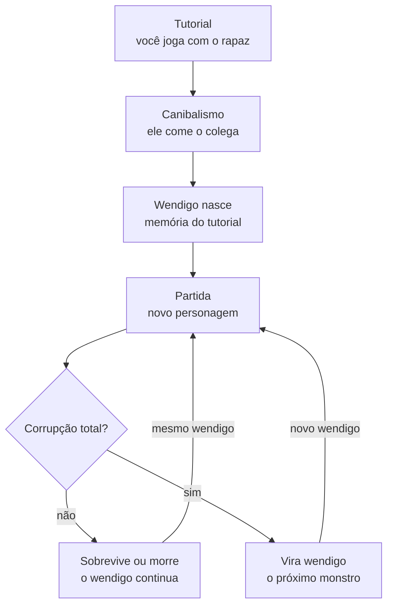

# Fome Branca — Documento de Design

26/10/2026

## Visão geral

*Fome Branca* (título provisório) é um jogo de sobrevivência e horror em primeira pessoa onde o monstro é o personagem que você controlou no tutorial. Você aprende a sobreviver, é forçado a comer seu colega para não morrer, e na partida seguinte enfrenta o wendigo que você mesmo se tornou.

**Plataforma e formato**

- Engine: Godot 4
- Câmera: 3D em primeira pessoa
- Plataforma inicial: PC
- Estrutura: tutorial narrativo + partidas de sobrevivência em ciclo

**Pilares de design**

1. **O monstro é você.** Tudo o que o jogador faz no tutorial volta contra ele depois: as rotas, os esconderijos, as escolhas.
2. **Sobrevivência simples, decisões pesadas.** Poucos recursos (calor, fome, luz), mas cada escolha custa algo.
3. **A fome corrompe.** Comer carne humana é sempre uma opção tentadora, e sempre tem um preço.
4. **Um lugar só, cada vez mais conhecido.** O mesmo vale nevado do começo ao fim; a familiaridade vira medo.

**Referências**

- *The Long Dark*: sobrevivência no frio, ritmo lento, isolamento
- *Until Dawn*: wendigos e culpa como tema
- *Alien: Isolation* e *Amnesia*: um único predador, se esconder em vez de lutar
- *Spec Ops: The Line*: o jogo usando as ações do jogador contra ele

**Sobre o mito:** o wendigo vem das tradições de povos algonquinos (como Cree, Ojibwe e Innu), ligado a fome extrema, ganância e canibalismo em invernos rigorosos. A proposta é tratar o tema com respeito, focando no horror da fome e da culpa, sem caricaturar essas culturas.

## História e premissa

A história se divide em dois atos no mesmo vale: no primeiro você vira o monstro, no segundo você enfrenta ele.

**Ato 1 — O tutorial**

Dois amigos fazem uma trilha de inverno num vale remoto. Uma nevasca fecha a saída e eles se abrigam numa cabana de caça. Enquanto o jogador aprende a coletar lenha, acender fogo, caçar e racionar comida, o colega vai piorando (ferimento, febre ou hipotermia).

O colega morre numa das noites. A nevasca não para, a comida acaba e as opções de caça desaparecem. A única interação restante é o corpo. O jogador pode recusar algumas vezes, ficando mais fraco a cada recusa, até ceder. A tela escurece. Nos últimos minutos, o personagem começa a ouvir coisas e o reflexo dele na janela já não parece certo.

**Transição**

Corte seco. Um texto simples marca o tempo: *"Três invernos depois."*

**Ato 2 — A partida**

Um novo personagem chega ao vale por outro motivo (resgate, pesquisa, caça). Ele não sabe o que aconteceu ali. O jogador sabe. A cabana está abandonada, há ossos perto da antiga fogueira e algo caça na floresta à noite.

O objetivo é sobreviver até o resgate chegar, ou encontrar e destruir o coração de gelo do wendigo.

**Tema central:** a fome transforma pessoas. O jogo pergunta ao jogador, repetidas vezes, até onde ele vai para sobreviver, e mostra o resultado.

## Estrutura do jogo

O tutorial roda uma vez; depois, cada partida pode gerar o wendigo da partida seguinte.

A primeira partida sempre enfrenta o rapaz do tutorial; a partir daí, quem sucumbe à corrupção vira o próximo monstro.

**Como cada partida pode terminar**

- **Resgate:** o jogador sobrevive até o resgate chegar. O wendigo atual continua no vale para a próxima partida.
- **Morte** (frio, fome ou o wendigo): o wendigo atual continua. Se a morte também deve alimentar o ciclo está nas questões em aberto.
- **Transformação:** a corrupção chega ao máximo. O personagem vira o novo wendigo, usando as rotas e esconderijos daquela partida.
- **Coração de gelo destruído:** o final verdadeiro. O wendigo atual morre e o vale fica livre até alguém se corromper de novo.

**Duração proposta:** tutorial de 15 a 20 minutos; partidas de 45 a 90 minutos.

## Mecânicas de sobrevivência

Três recursos sustentam todo o jogo: calor, fome e luz. Cada um tem um medidor simples e uma consequência clara quando zera.

| Recurso | Cai quando | Recupera com | Se zerar |
| --- | --- | --- | --- |
| Calor | Fica ao ar livre, à noite, molhado, na nevasca | Fogueira, abrigo, roupas | Visão embaça, movimento lento, depois morte |
| Fome | Com o tempo, mais rápido correndo ou no frio | Caça, pesca, enlatados, carne humana | Calor cai mais rápido, tremores, depois morte |
| Luz | Tocha e lanterna se gastam | Lenha, gordura animal, pilhas raras | Escuridão total; o wendigo enxerga, você não |

**Ciclo diário**

- Dia: mais seguro, tempo para explorar e coletar
- Entardecer: hora de voltar para o abrigo
- Noite: frio intenso e o wendigo caça ativamente
- Nevascas aleatórias reduzem a visibilidade e o calor a qualquer hora

**Ações básicas**

- Coletar: lenha, gravetos, pedras, pele, gordura
- Acender e manter fogueira (o recurso mais importante do jogo)
- Caçar coelhos e pescar no lago congelado
- Cozinhar e racionar comida
- Craft simples: tocha, armadilha, curativo, roupa de pele
- Esconder-se: armários, sob a cabana, em fendas de rocha

**Inventário:** limitado por peso, para forçar escolhas entre comida, lenha e ferramentas.

**Sem combate direto contra o wendigo.** O jogador pode afastá-lo com fogo e atrasá-lo com armadilhas, mas só consegue matá-lo destruindo o coração de gelo.

## Fome e corrupção

Comer carne humana é sempre a opção mais eficiente e sempre aumenta a corrupção; se a corrupção encher, o personagem vira o próximo wendigo.

**No tutorial** o canibalismo é inevitável e roteirizado. O jogador pode recusar o corpo algumas vezes, mas cada recusa custa calor e força, até que comer seja a única forma de continuar. Quantas vezes ele recusou fica registrado e muda detalhes do wendigo depois (ver *O Wendigo*).

**Na partida** o canibalismo é uma escolha. O vale tem restos humanos: outras vítimas, viajantes perdidos, o que o wendigo deixou para trás.

| Fonte de comida | Fome recuperada | Corrupção | Observação |
| --- | --- | --- | --- |
| Enlatados | Baixa | Nenhuma | Raros, só no início |
| Peixe / coelho | Média | Nenhuma | Exige tempo e exposição ao frio |
| Carne crua | Média | Leve | Risco de doença |
| Carne humana | Muito alta | Alta | Também dá calor e visão noturna temporários |

**Efeitos da corrupção por estágio**

1. **Leve:** sussurros esporádicos, fome volta mais rápido.
2. **Média:** o personagem enxerga melhor no escuro e sente menos frio; o wendigo passa a ignorá-lo às vezes.
3. **Alta:** comida comum quase não sacia; alucinações com a voz do colega; as mãos mudam na câmera em primeira pessoa.
4. **Total:** transformação. A partida termina e esse personagem vira o wendigo da próxima.

A corrupção cria a tentação central do jogo: ficar mais forte agora ao custo de virar o monstro depois. Ela só diminui com algo raro e custoso (por exemplo, um ritual na cabana ou um item específico), a definir.

## O Wendigo

O wendigo é o único inimigo do jogo, e a IA dele é construída a partir do que o jogador fez como humano.

**Memória do tutorial**

Durante o tutorial o jogo grava, sem o jogador saber:

- Onde ele acendeu fogueiras
- Onde se escondeu e onde dormiu
- As trilhas que mais usou
- Onde guardou comida e ferramentas
- Quantas vezes recusou comer o colega

Na partida, o wendigo patrulha esses pontos. Os esconderijos favoritos do tutorial são os primeiros lugares que ele checa. A rota mais usada vira o caminho de caça dele.

**Comportamento**

| Estado | Gatilho | O que faz |
| --- | --- | --- |
| Vagando | Padrão, mais ativo à noite | Percorre as rotas e pontos memorizados |
| Desconfiado | Ouve barulho ou vê luz distante | Vai investigar, devagar |
| Caçando | Vê o jogador | Persegue rápido; perde o rastro se o jogador se esconder bem |
| Recuando | Fogo forte por perto | Circula a luz à distância, esperando ela apagar |
| Atraindo | Jogador escondido por muito tempo | Imita vozes para tirá-lo do esconderijo |

**Imitação de voz:** o wendigo chama com a voz do colega morto, usando falas que o jogador ouviu no tutorial ("ei, me ajuda aqui", "tô com frio"). Mais tarde, pode usar a voz do próprio personagem do tutorial.

**Crescimento:** cada vez que come (um animal, um corpo, o jogador), fica maior e mais rápido, mas também mais faminto e mais barulhento.

**Detalhes reconhecíveis:** carrega restos do personagem do tutorial, como o cachecol ou a lanterna quebrada pendurada no corpo. Se o jogador recusou muitas vezes comer o colega, o wendigo hesita por um instante ao ver o jogador, um resto de humanidade.

**Fraquezas**

- Fogo afasta, mas não mata
- Não entra em construções com fogueira acesa
- Só morre se o coração de gelo for destruído

**O coração de gelo:** fica escondido num lugar ligado ao tutorial (por exemplo, onde o colega morreu). Encontrá-lo exige seguir pistas (diário, ossos, marcas) e destruí-lo exige fogo intenso, preparado com antecedência.

## Personagens

Três personagens fixos sustentam a história; nomes e detalhes são provisórios.

| Personagem | Papel | Perfil | Função no jogo |
| --- | --- | --- | --- |
| O rapaz (protagonista do tutorial) | Vira o wendigo | Vinte e poucos anos, inexperiente, leal ao amigo | Ensina as mecânicas; suas ações moldam o monstro |
| O colega | Morre no tutorial | Mais experiente, foi quem planejou a trilha | Dá dicas durante o tutorial; sua voz é usada pelo wendigo depois |
| A segunda protagonista | Personagem da partida | Mais velha, preparada, chega ao vale por outro motivo | Habilidades diferentes; não sabe o que aconteceu ali |

**Por que a segunda protagonista deve ser bem diferente:** o contraste reforça que é outra pessoa, com outro corpo e outras habilidades, enfrentando algo que o jogador criou. Ela pode ter, por exemplo, mais resistência ao frio e melhor mira, mas menos conhecimento do terreno, que o jogador compensa com a própria memória do tutorial.

**Personagens do ciclo:** a partir da segunda partida, cada novo protagonista pode ser sorteado de uma lista com perfis variados (guarda-florestal, fotógrafa, caçador, pesquisadora), cada um com uma vantagem e uma fraqueza.

## Mapa e ambiente

O jogo usa um único vale nevado, pequeno o bastante para o jogador decorar, e que muda entre o tutorial e a partida.

**Locais-chave**

| Local | No tutorial | Na partida |
| --- | --- | --- |
| Cabana de caça | Abrigo principal, fogueira, onde o colega morre | Abandonada, porta arrancada, ossos perto da lareira |
| Lago congelado | Pesca, primeira lição de comida | Gelo rachado; sinais de algo arrastado |
| Floresta de pinheiros | Coleta de lenha e caça | Território de caça do wendigo à noite |
| Trilha da saída | Bloqueada pela nevasca | Ponto do resgate, longe e exposto |
| Caverna / fenda de rocha | Esconderijo opcional | Possível toca do wendigo |
| Torre de vigia | Vista do vale, sinal de rádio fraco | Rádio para chamar o resgate |

**Como o mapa conta a história**

- Objetos deixados pelo jogador no tutorial continuam onde ficaram
- O diário do rapaz fica na cabana; as últimas páginas mostram a transformação
- Marcas de garras, árvores descascadas e carcaças indicam onde o wendigo passa
- Os lugares onde o jogador acendeu fogueiras no tutorial aparecem como cinzas antigas

**Tamanho sugerido:** algo em torno de 1 km², atravessável a pé em poucos minutos de dia, mas perigoso de cruzar à noite. Um mapa pequeno e denso combina com o escopo e com a ideia de familiaridade.

## Atmosfera

O medo vem do som e do que o jogador não vê, não de sustos baratos.

**Visual**

- Paleta fria e dessaturada: branco, cinza, azul escuro; o fogo é a única cor quente
- Neblina e neve volumétrica limitando a visão
- Estilo semi-realista low-poly, viável para um projeto pequeno no Godot
- O wendigo quase nunca é visto por inteiro: silhuetas, olhos refletindo luz, chifres entre as árvores

**Áudio (o pilar mais importante do horror)**

- Vento constante, que abafa outros sons e cria tensão
- Passos na neve com volume conforme a distância; o jogador aprende a ouvir o wendigo
- Galhos estalando, respiração pesada, ossos sendo roídos ao longe
- A voz do colega gravada no tutorial e reaproveitada pelo monstro
- Silêncio absoluto quando o wendigo está muito perto

**HUD mínimo**

- Sem barras na tela por padrão: o estado do personagem aparece no corpo e na câmera (respiração visível, tremor, visão escurecendo, estômago roncando)
- Um diário/inventário acessado por tecla mostra os medidores quando o jogador quer conferir
- A corrupção aparece em mudanças sutis: cor das mãos, vinheta avermelhada, sussurros

## Notas técnicas para Godot

O projeto cabe bem no Godot 4 com GDScript; o sistema mais importante e incomum é o registro do tutorial que alimenta a IA do wendigo.

**Sistemas e nós sugeridos**

| Sistema | Abordagem no Godot |
| --- | --- |
| Jogador | `CharacterBody3D` + `Camera3D`, script de primeira pessoa |
| Sobrevivência | Autoload `SurvivalStats` com calor, fome, luz e corrupção; sinais quando um valor muda de estágio |
| Tempo e clima | Autoload `WorldClock` controlando ciclo dia/noite, `DirectionalLight3D` e nevascas |
| Neve e neblina | `GPUParticles3D` para neve; `WorldEnvironment` com fog volumétrico (renderizador Forward+) |
| Wendigo | `CharacterBody3D` + `NavigationAgent3D` sobre um `NavigationRegion3D`; máquina de estados (Vagando, Desconfiado, Caçando, Recuando, Atraindo) |
| Sentidos do wendigo | `RayCast3D` / `Area3D` para visão; eventos de ruído emitidos pelo jogador com posição e volume |
| Esconderijos | `Area3D` marcando pontos de esconderijo, cada um com um id |
| Áudio | `AudioStreamPlayer3D` para passos, vozes e ambiente |
| Interação | `RayCast3D` na câmera + interface `interact()` nos objetos |

**Registro do tutorial (a peça-chave)**

1. Um autoload `TutorialRecorder` escuta eventos durante o tutorial: fogueira acesa, esconderijo usado, item guardado, recusa do corpo.
2. A posição do jogador é amostrada a cada poucos segundos para montar um mapa de calor das rotas.
3. Ao final do tutorial, tudo é salvo em `user://` como um `Resource` personalizado (ou JSON).
4. Na partida, o wendigo carrega esse arquivo e transforma os pontos mais visitados em pontos de patrulha com peso.

**Ciclo de wendigos**

- Quando um personagem atinge corrupção total, o jogo grava um novo registro com as rotas e esconderijos daquela partida
- O wendigo da partida seguinte usa esse novo registro
- Manter um histórico permite, no futuro, mais de um wendigo no mapa ou referências a vítimas anteriores

## Escopo do MVP e roadmap

O MVP prova uma coisa só: que enfrentar um wendigo que usa as suas próprias rotas do tutorial é assustador.

**Dentro do MVP**

- Um mapa pequeno com a cabana, o lago, a floresta e um esconderijo
- Calor, fome e luz funcionando
- Tutorial curto (15 a 20 minutos) terminando no canibalismo
- Registro do tutorial salvando fogueiras, esconderijos e rotas
- Wendigo com três estados (Vagando, Caçando, Recuando) usando esse registro
- Uma condição de vitória: sobreviver até o resgate

**Fora do MVP (depois)**

- Coração de gelo, imitação de voz, corrupção completa e ciclo de wendigos
- Personagens sorteados, crafting expandido, clima dinâmico completo

**Fases**

1. **Base:** movimento em primeira pessoa, interação, cabana e terreno de teste. *Pronto quando* dá para andar, pegar lenha e acender fogo.
2. **Sobrevivência:** medidores, ciclo dia/noite, comida e frio. *Pronto quando* dá para morrer de frio ou de fome.
3. **Tutorial:** colega, eventos roteirizados, morte e canibalismo, registro do tutorial. *Pronto quando* o tutorial pode ser jogado do início ao fim.
4. **Wendigo:** IA com patrulha baseada no registro, perseguição e medo de fogo. *Pronto quando* um testador sente que o monstro "sabe" onde ele se esconde.
5. **Ciclo e polimento:** corrupção, voz, coração de gelo, áudio e atmosfera.

## Questões em aberto

- [ ] Qual o título final? *Fome Branca* é provisório.
- [ ] Como o colega morre: ferimento, febre ou hipotermia?
- [ ] O canibalismo no tutorial é mostrado ou só sugerido (tela escura, som)?
- [ ] Existe alguma forma de reduzir a corrupção, e quão rara ela é?
- [ ] Quanto tempo o jogador precisa sobreviver até o resgate?
- [ ] O jogador pode rejogar o tutorial para gerar um wendigo diferente?
- [ ] Quantos wendigos do ciclo podem existir no mapa ao mesmo tempo?
- [ ] Vozes: gravar com dubladores ou usar vozes sintéticas no protótipo?
- [ ] Morte normal (de frio, fome ou pelo wendigo) também conta para o ciclo, ou só a transformação?
